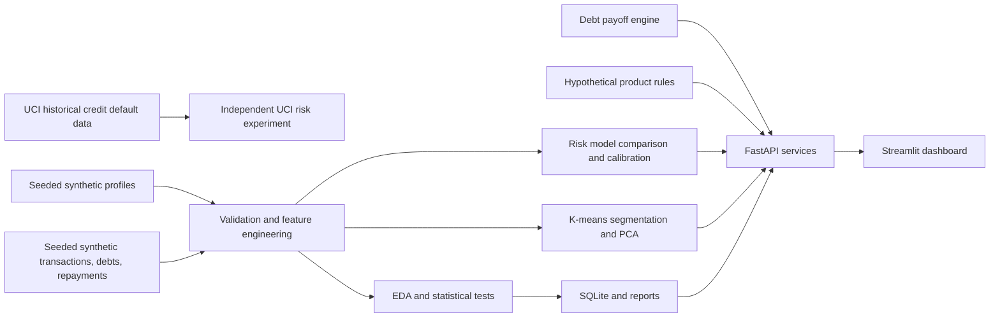
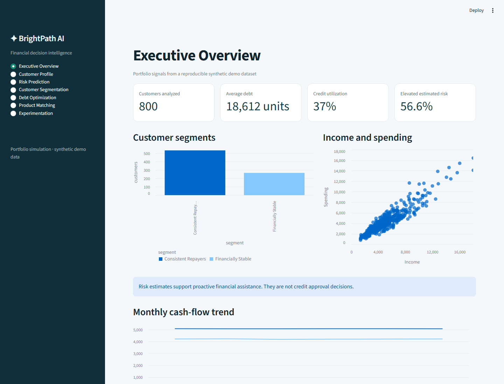

# BrightPath AI

BrightPath AI is a reproducible portfolio simulation for consumer-finance decision support. It combines financial behaviour analysis, repayment-risk estimates, behavioural segments, debt payoff projections, transparent hypothetical product matching, and a simulated experiment in a FastAPI + Streamlit application.

> **Scope:** This project is not a lending system, does not approve or deny credit, and is not financial advice. Synthetic customer, transaction, repayment, and experimental results are labelled as such. Public historical data is isolated from the synthetic dashboard profiles.

## Business problem

The project explores how a consumer-finance team could identify customers who may benefit from payment support, understand affordability patterns, compare payoff methods, and test whether personalized guidance helps. The model is used to prioritize supportive interventions in a simulation, never to make an automated credit decision.

## Architecture



## Data sources and licenses

| Source | Use | Provenance |
|---|---|---|
| [UCI Default of Credit Card Clients, dataset 350](https://archive.ics.uci.edu/dataset/350/default%2Bof%2Bcredit%2Bcard%2Bclients) | Optional independent historical next-month default modeling | 30,000 Taiwan credit-card records; data from 2005. Licensed CC BY 4.0. Cite: Yeh, I. (2009), [UCI dataset DOI](https://doi.org/10.24432/C55S3H). |
| Generated demo tables | Dashboard, behaviour features, clustering, optimization, experiment | Deterministic synthetic records created by `brightpath.data.synthetic`; seed and customer count are configurable. No private or Bright Money data is used. |

The generated table and model-feature dictionaries are in `reports/data_dictionary.json` after the pipeline runs. Employment tenure and credit-history length remain profile fields for descriptive analysis, but are deliberately excluded from risk model features because they can act as age proxies.

To download and model the UCI data separately, install the `data` extra and run `python scripts/train_uci.py`. The loader excludes ID, sex, age, marital status and education from model features. The UCI dataset is not joined to synthetic customer or transaction records. If download access is unavailable, the primary demo remains fully runnable using synthetic data.

## Data dictionary

The generated profile, transaction, debt and repayment tables are stored separately in SQLite and as CSVs. `reports/data_dictionary.json` documents model features. Selected fields:

| Feature | Meaning |
|---|---|
| `monthly_income` | Profile monthly income (synthetic). |
| `credit_utilization_ratio` | Current revolving balance divided by limit. |
| `debt_to_income_ratio` | Required monthly debt payments divided by gross monthly income. |
| `expense_to_income_ratio` | Mean monthly debit outflow divided by income. |
| `monthly_savings_ratio` | One minus the observed expense-to-income ratio; can be negative. |
| `spending_volatility` | Standard deviation of monthly debit outflow divided by mean debit outflow. |
| `recent_delinquency_frequency` | Missed/late payment share in the latest three observed periods. |
| `emergency_savings_coverage` | Liquid savings divided by observed monthly spending. |
| `simulated_missed_payment_next_month` | Synthetic outcome label; excluded from predictors. |

## Reproduce the outputs

Python 3.11 or newer is recommended. All demo artifacts can be regenerated from the fixed seed:

```bash
python -m venv .venv
# Windows PowerShell: .venv\Scripts\Activate.ps1
# macOS/Linux: source .venv/bin/activate
pip install -r requirements.txt
python scripts/run_pipeline.py --customers 800 --seed 42
```

The pipeline creates the linked synthetic tables, quality checks, engineered features, SQLite database, EDA report, model comparison, segmentation, experiment, monitoring log and local artifacts. Generated datasets and fitted models are ignored by Git and should be regenerated locally.

### Latest generated demo run

This section is populated from `reports/run_summary.json` after running the pipeline. Values describe the seeded synthetic simulation, not real consumers. Model metrics in `models/model_metrics.json` include the test-set confusion matrix, precision, recall, F1, ROC-AUC, PR-AUC, specificity, false positive/negative rates, calibration curve, and Brier score.

<!-- GENERATED_RUN_SUMMARY_START -->
Seed 42 generated **800 customer profiles**, **38,400 transactions**, **2,336 debt accounts**, and **2,783 repayment observations**. The synthetic target's positive rate was **33.5%**.

| Risk-model result | Value |
|---|---:|
| Selected model | Tuned Random Forest (max_depth=5, n_estimators=200) |
| Test split | 200 stratified customers; threshold 0.225 |
| PR-AUC / ROC-AUC | 0.602 / 0.704 |
| Accuracy / precision / recall / F1 | 0.570 / 0.419 / 0.731 / 0.533 |
| Specificity / false positive rate / false negative rate | 0.489 / 0.511 / 0.269 |
| Brier score | 0.191 |
| Confusion matrix | TN 65, FP 68, FN 18, TP 49 |

Cross-validation PR-AUC / recall at threshold 0.5: Logistic Regression **0.535 / 0.617**, Decision Tree **0.540 / 0.597**, Random Forest **0.645 / 0.567**, Gradient Boosting **0.627 / 0.468**, Tuned Random Forest **0.646 / 0.552**. Selection used a 0.45 recall floor, then CV PR-AUC. The operating threshold uses training-only out-of-fold probabilities under a 3:1 false-negative cost assumption. The holdout false-positive rate is 51.1%; this is an illustrative support setting. Accuracy alone can obscure missed cases on an imbalanced target, so PR-AUC, recall, calibration and the error trade-off are reported.

EDA found mean utilization of 42.2% for simulated missed-payment cases versus 34.1% for on-time cases (difference 8.2 percentage points, 95% CI 5.3 to 11.1 points, Welch p=3.4e-08, Cohen's d=0.42). Debt-payment-to-income ratio was 15.2% versus 12.7% (difference 2.5 percentage points, 95% CI 1.3 to 3.8 points, p=8.8e-05). Spending volatility was 6.02% versus 5.93% (p=0.558), so the example volatility hypothesis was not supported. The >=70% utilization chi-square test had p=0.000269, Cramer's V=0.129. These associations describe the generated target mechanism and are not evidence about real consumers.

K-means selected **2 clusters** (silhouette 0.207; second-seed ARI 1.000): 534 `Consistent Repayers` (on-time share 92.9%, utilization 32.8%, savings coverage 4.5 months); 266 `Financially Stable` (on-time share 38.8%, utilization 44.8%, savings coverage 1.6 months). Names are assigned from the observed generated cluster profiles.

In the randomized **simulation**, treatment on-time rate was 85.5% versus 84.2% in control, a 1.2-point difference (95% CI -3.7 to 6.2 percentage points, p=0.622); this simulated on-time difference is not statistically significant at 5%. Simulated mean debt reduction differed by 93.84 units (95% CI -7.93 to 195.60, Welch p=0.0707); this difference is not statistically significant at 5%. Generic/personalized acceptance was 25.5%/68.5%. Estimated interest saved was 185/1,553 units for control/treatment under the stated simulator rules. These are not real customer outcomes or causal evidence.
<!-- GENERATED_RUN_SUMMARY_END -->

## EDA and statistical investigation

`brightpath.evaluation.eda` writes means, medians, modes, variance, standard deviation, quantiles, skewness, kurtosis, correlations, and hypothesis tests. It compares missed/late and on-time synthetic groups using Welch t-tests and Mann–Whitney tests, tests utilization group independence with chi-square, and reports confidence intervals for mean differences. The null and alternative hypotheses and a plain-language interpretation accompany the values. Statistical significance in a generated sample is not evidence of real-world impact; practical significance depends on effect size and a real target population.

## Feature engineering and modeling

Customer features aggregate six months of transaction history and prior repayments. The next-month target is simulated only after those historical inputs; it is not among `MODEL_FEATURES`. Imputation and scaling are fitted inside train-fold pipelines. A stratified holdout is kept out of selection. Logistic regression, a decision tree, random forest, and gradient boosting are compared with stratified cross-validation; a small random-forest grid is evaluated on training folds. The best cross-validated PR-AUC model is calibrated, and a 3:1 false-negative to false-positive intervention cost assumption selects the threshold from out-of-fold training predictions.

The final model is selected for PR-AUC and supportive-intervention recall, not raw accuracy. Global permutation importance and per-customer median-perturbation sensitivities provide explanations. They indicate model behaviour, not causation. SHAP is not required for this implementation.

The separate UCI model predicts the historical Taiwan dataset's next-month default label and has a distinct feature schema and artifact under `models/uci/`. Its results do not transfer automatically to the synthetic dashboard or another population. Employment tenure and credit-history duration stay in the synthetic profile for analysis but are omitted from risk scoring because they can act as age proxies.

## Customer segmentation

The segmentation service scales nine financial behaviour features, checks K-means solutions for 2–6 clusters with silhouette score, compares a second seeded fit using adjusted Rand index, and projects results into two PCA coordinates. Human-readable labels are assigned after examining cluster averages against portfolio medians. Segment characteristics, challenges, interventions, sizes and business opportunities are saved in `reports/segmentation_summary.json`. Labels are exploratory, not eligibility categories.

## Debt payoff optimization

Both strategies accrue monthly interest as `balance × APR / 12` before payment. Each active debt receives the lesser of its balance and the stated minimum; the remaining fixed budget goes to the avalanche (highest APR) or snowball (lowest balance) priority. The personalized comparison chooses lower modeled interest when both plans pay off, and lower remaining balance at the simulation horizon otherwise. A plan is rejected when the budget is below required minimum payments. Zero balances and zero-interest debts are supported. Projections assume constant rates and payments and exclude fees, new borrowing, and due-date timing.

## Product matching

The sample catalogue contains a secured credit-building product, a fixed-term consolidation scenario, a savings product and a free payment-calendar tool. Suitability scores use explicit eligibility, affordability, customer benefit and fee components. Credit-consolidation rules compare sample APR with balance-weighted debt APR and check the monthly budget and debt-payment-to-income ratio. Credit-builder rules use observed repayment consistency and deposit affordability, not credit-history duration. No demographic fields or direct duration proxies are passed to these rules. Financial variables can still have disparate impacts and require testing before any real use. All catalogue terms and rates are hypothetical; no real approval is predicted.

## Experimentation

The seeded simulation randomly assigns profiles to a generic control or personalized treatment, then generates on-time outcomes, acceptance and debt reduction using the assumptions saved in `reports/experiment_summary.json`. It reports a difference-in-proportions confidence interval, two-sided z-test, Cohen's h, and Welch comparison for debt reduction. Any uplift is a consequence of the explicit scenario assumptions and random seed; it is not fabricated real-world impact or causal evidence. A real test should pre-register the primary outcome, eligibility, sample size, guardrails, stratification, duration, and intent-to-treat analysis, with fairness and harm monitoring.

## Run the applications

First activate the project virtual environment in each terminal and generate the data and model artifacts with the pipeline. From PowerShell, run this once in Terminal 1:

```powershell
.\.venv\Scripts\Activate.ps1
python scripts\run_pipeline.py --customers 800 --seed 42
```

Keep that environment active and start the API in Terminal 1. Activate the same environment in Terminal 2 and start the dashboard:

```powershell
# Terminal 1
python -m uvicorn backend.main:app --reload --port 8000

# Terminal 2 (from the project root)
.\.venv\Scripts\Activate.ps1
python -m streamlit run app/dashboard.py
```

The dashboard has seven views: Executive Overview, Customer Profile, Risk Prediction, Customer Segmentation, Debt Optimization, Product Matching and Experimentation. Its prediction, profile, payoff and matching interactions call the FastAPI service. API documentation is available at [http://127.0.0.1:8000/docs](http://127.0.0.1:8000/docs). Set `BRIGHTPATH_API_URL` when the API is hosted elsewhere.

### Dashboard screenshot

Captured from the running Streamlit application after the pipeline generated its synthetic demo data. The screenshot shows the Executive Overview at 1440 × 1100 pixels.



### Docker

```bash
docker compose up --build
```

The dashboard is served on port 8501 and the API on port 8000. The image build creates an 800-customer synthetic demo dataset and artifacts.

## REST API

| Method | Endpoint | Purpose |
|---|---|---|
| GET | `/health` | Service and artifact readiness. |
| GET | `/dashboard-summary` | Aggregate demo metrics for the overview. |
| GET | `/customer/{customer_id}/profile` | Profile, debts and repayment history. |
| POST | `/predict-risk` | Estimated future missed-payment probability and local sensitivities. |
| POST | `/segment-customer` | Exploratory segment assignment. |
| POST | `/optimize-debt` | Avalanche, snowball and personalized schedules. |
| POST | `/match-products` | Ranked hypothetical product examples. |

The API validates request types and finance ranges with Pydantic, returns 404 for unknown demo IDs and 422 for invalid affordability inputs, and documents its schema in OpenAPI.

## SQL analytics

`sql/analytics.sql` contains customer financial summaries, monthly transaction aggregations with `LAG`, repayment rates by segment, cohort analysis, cumulative payments with a window frame, segment-level rankings, and simulated outcome rates. It uses CTEs, joins and window functions. Run the queries against `data/brightpath.sqlite` after the pipeline; see `sql/README.md` for the business purpose and execution notes.

## Monitoring and responsible use

The batch monitor records prediction distribution, input missingness, per-feature PSI drift, and optional delayed-label PR-AUC/ROC-AUC/Brier metrics. `reports/monitoring.jsonl` is a local example, not a production monitoring service. Retraining is reproducible with `python scripts/run_pipeline.py`; model version and training metadata are stored with the joblib artifact and JSON report.

Protected demographic fields are excluded from the optional UCI model. The synthetic demo does not model protected characteristics. Subgroup metrics are not claimed because no production demographic groups are available. The data is dated or generated, labels are imperfect, and all predictions and financial outputs carry uncertainty. A production system would require legal, privacy, security, fairness, suitability, consent and independent validation review.

## Tests

```bash
python -m unittest discover -s tests -v
# Or, after installing the test extra: pytest
```

Tests cover data schemas and feature calculations, model loading/prediction, API validation and service routes, segmentation, product rules, experiment outputs, and debt-payoff edge cases. The pipeline is also the reproducible end-to-end build command.

## Limitations and future improvements

- The main dashboard data and experimental outcomes are synthetic.
- The public UCI data is historical, limited to a Taiwan issuer population and is not contemporary consumer finance data.
- The risk model illustrates workflow quality rather than production generalization or lending performance.
- Monthly amortization omits fees, new spend, irregular dates, variable rates, and payment calendars.
- Product rules and economics are hypothetical and need jurisdiction-specific compliance review before any real use.
- Future work could add real consented longitudinal data, temporal validation, richer calibration and subgroup reports, API authentication, database migrations, queue-based retraining, production drift alerts, and randomized field trials.
